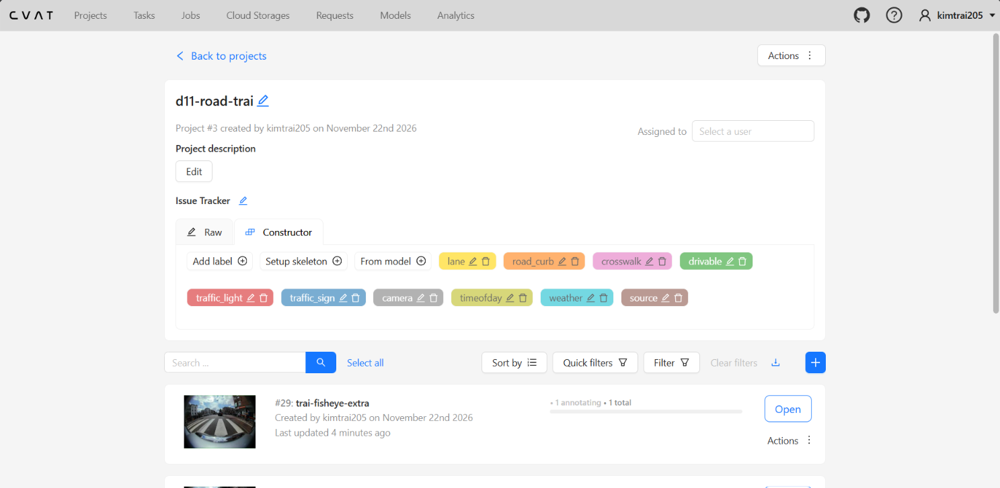
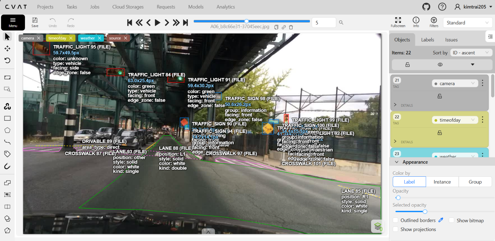
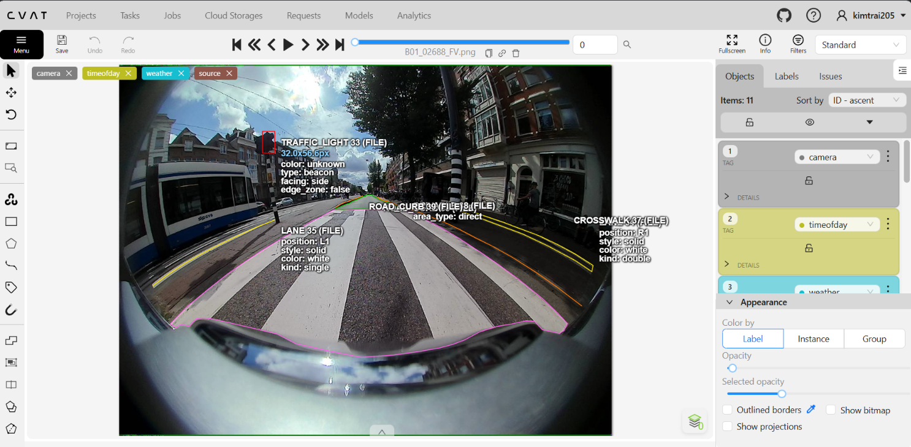
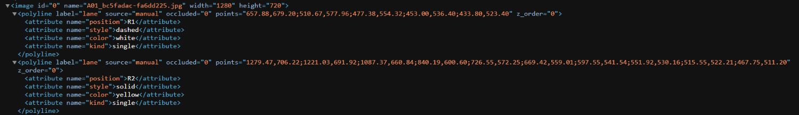

# Báo cáo cá nhân — Ngày 11
Họ tên: **Bùi Kim Trại**  Mã học viên: **2A202603176**  
Phiên bản CVAT (Help → About): **v2.82.0**  
Guideline: **Road v1.0**    Lần nộp (`revision` trong manifest): **1**  
Thời điểm export (ngày giờ trên CVAT): **21/11/2026 23:30**  Số lần nộp lại sau Rework: **0**

## 1. Kiểm project
| Mục | Đúng như guideline Road v1.0? | Ghi chú |
| --- | --- | --- |
| 6 label, đúng kiểu | Có | lane (polyline), road_curb (polyline), crosswalk (polygon), drivable (polygon), traffic_light (rectangle), traffic_sign (rectangle) |
| Thuộc tính và giá trị | Có | lane: position/style/color/kind; drivable: area_type; traffic_light: color/type/facing/edge_zone; traffic_sign: group/facing/edge_zone |
| 4 tag ảnh | Có | camera, timeofday, weather, source — mỗi tag có thuộc tính select `value` |

Cách tôi kết thúc polyline trên CVAT này: Nhấn phím **N** hoặc nhấp đúp chuột vào điểm cuối để kết thúc nét vẽ.  
Cách tôi đặt tag ảnh trên CVAT này: Chọn label loại Tag từ thanh công cụ bên trái, bấm dấu **+** để thêm tag vào ảnh, sau đó vào bảng Details bên phải chọn giá trị `value` tương ứng.

## 2. Số lượng đã gán
| Task | Ảnh | lane | road_curb | crosswalk | drivable | traffic_light | traffic_sign |
| --- | ---: | ---: | ---: | ---: | ---: | ---: | ---: |
| front (A01–A12) | 12 | 41 | 4 | 10 | 30 | 24 | 33 |
| front-extra (đã làm 4 / 4) | 4 | 17 | 2 | 6 | 11 | 7 | 16 |
| fisheye (B01–B08) | 8 | 28 | 14 | 12 | 19 | 9 | 12 |
| fisheye-extra (đã làm 4 / 4) | 4 | 10 | 3 | 5 | 6 | 0 | 0 |

*Số liệu task front và fisheye lấy từ file manifest; front-extra và fisheye-extra kiểm tra qua output của lệnh road_check lint.*

## 3. Bảng ca khó
| Ảnh | Nhãn | Phân vân giữa | Đã chọn | Lý do |
| --- | --- | --- | --- | --- |
| A05 | lane L1/R1 | Vẽ vạch suy đoán vs. bỏ qua | Không vẽ | Mặt đường thực tế không nhìn thấy vạch sơn rõ ràng; tôi đã hỏi và được Coach xác nhận miễn lỗi QC1-02. |
| A09 | lane R1 | Vẽ vạch suy đoán vs. bỏ qua | Không vẽ | Mép đường bên phải không phân biệt được vạch sơn hay ranh giới nhựa đường; Coach đã xem ảnh và xác nhận miễn R1. |
| A14 | lane R1 | Vẽ vạch suy đoán vs. bỏ qua | Không vẽ | Ảnh chụp ban đêm rất tối, vạch bên phải bị nhòe hoàn toàn; Coach đã xác nhận trường hợp này không vẽ. |
| A06 | lane other | Gán nhãn lane hay bỏ qua vạch dừng ngang giao lộ | Gán lane, position=other, occluded=1 | Tôi thấy có vệt sơn rõ ràng trên đường nên vẫn gán nhãn, chọn position=other để phân biệt với vạch dọc làn chạy. Lệnh lint cảnh báo chiều vẽ do vạch nằm ngang nên tọa độ y hai đầu xấp xỉ nhau. |
| A08 | lane other | Gán nhãn lane hay bỏ qua vạch ngang giao lộ | Gán lane (với position=other) | Ban đầu tôi thấy nét sơn ngang nên gán lane other; sau khi bạn Quang kiểm và chỉ ra vạch ngang không phải vạch phân luồng làn xe, tôi nhận thấy đây là lỗi và đã xóa bỏ. |
| A10 | drivable | Khoét polygon theo thân xe hay vẽ phủ qua mặt đường dưới gầm xe | Khoét lẹm theo thân xe | Ban đầu tôi nghĩ xe che khuất thì không lái được; nhưng đối chiếu kỹ lại guideline thì drivable phải thể hiện vùng mặt đường đi được khi đường trống, không được bám theo đường bao thân xe. |
| B02 | lane R1 | Vẽ 1 polyline hở hay vẽ khép kín ôm cả hai mép vạch đôi | Vẽ vòng theo 2 mép tạo đường bao | Tôi nhầm lẫn cách gán cho vạch đôi; đúng quy tắc guideline là chỉ vẽ một đường polyline hở chạy dọc tâm vạch từ gần ra xa, sau đó đặt thuộc tính kind=double. |
| B10 | traffic_light / traffic_sign | Có gán biển/đèn ở góc camera bên trái không | Không gán | Góc fisheye bên hông xe, các đối tượng ở quá xa và mờ méo mó, không đủ độ tin cậy để đóng box chuẩn. |

## 4. Phiếu QC 1 nhận được
Bạn kiểm lô của tôi: **Ngô Thị Minh Quang** (`ngothiminhquang`)  
Quyết định nhận được: **Rework**

Tôi đồng ý với các nhận xét và lỗi bạn Quang đã chỉ ra, cụ thể:

| Mã lỗi | Số lỗi | Đồng ý? | Đã sửa? |
| --- | ---: | --- | --- |
| QC1-03 | 1 | Đồng ý | Đã xóa lane#32 (vạch ngang giao lộ) tại ảnh A08. |
| QC1-04 | 1 | Đồng ý | Đã vẽ lại lane#3 R1 tại ảnh B02 thành polyline hở chạy dọc tâm từ gần ra xa. |
| QC1-07 | 3 | Đồng ý | Đã vẽ lại 3 polygon drivable tại ảnh A10 theo diện tích mặt đường, không khoét theo thân xe. |
| QC1-09 | 1 | Đồng ý | Đã đổi traffic_sign#9 tại ảnh A10 sang group prohibitory (biển cấm dừng/đỗ). |

**Các ca mơ hồ tôi đã trao đổi trực tiếp và được Coach xác nhận:**  
- **A05 (thiếu L1/R1):** Coach xác nhận miễn — ảnh thực tế không có vạch sơn rõ ràng.  
- **A09 (thiếu R1):** Coach xác nhận miễn — vạch bên phải mờ, lẫn vào mép đường.  
- **A14 (thiếu R1):** Coach xác nhận miễn — ảnh chụp ban đêm, vạch phải bị tối hoàn toàn.  
- **A06 (cảnh báo chiều vẽ):** Coach xác nhận không phải lỗi — polyline `position=other` là vạch dừng ngang giao lộ nên tọa độ y đầu-cuối xấp xỉ bằng nhau.

## 5. Kiểm file export
| File | Mở lại được? | Số shape ảnh 1 (job / file) | Số shape ảnh 2 (job / file) | Tag camera có trong XML? |
| --- | --- | --- | --- | --- |
| trai-front.zip | Có | A01: 8 / 8 (lane 4, drivable 3, traffic_sign 1) | A02: 7 / 7 (lane 3, drivable 3, road_curb 1) | Có — `<tag label="camera"><attribute name="value">front</attribute>` |
| trai-fisheye.zip | Có | B01: 7 / 7 (lane 2, drivable 1, road_curb 2, crosswalk 1, traffic_light 1) | B02: 10 / 10 (lane 2, drivable 2, road_curb 1, crosswalk 2, traffic_light 3) | Có — đúng theo hậu tố FV/RV/MVL/MVR |

Kết quả tôi chạy lệnh lint sau khi export:
```powershell
$env:PYTHONPATH="src"
python -m road_lab.road_check lint trai-front.zip trai-fisheye.zip
```
Kết quả hiển thị 20 ảnh với 4 cảnh báo (3 cảnh báo thiếu L1/R1 ở A05/A09 và 1 cảnh báo chiều vẽ ở A06) — tất cả đều đã được Coach xác nhận miễn ngoại lệ.

## 6. Ảnh chụp màn hình

1. **Tab Labels của project** — hiển thị đủ 6 label vẽ và 4 label Tag với các thuộc tính:  
   

2. **Một ảnh camera trước đã gán đủ (làn, vùng lái, đèn/biển)** — ảnh A08:  
   

3. **Một ảnh fisheye đã gán, phóng to đoạn polyline cong** — ảnh B03:  
   

4. **Đoạn XML có `<polyline label="lane">` trích từ file bài làm**:  
   

## 7. Tự đánh giá

**Lỗi tôi mắc nhiều nhất hôm nay:** QC1-07 (vẽ polygon vùng lái `drivable` bị khoét lẹm theo thân xe phía trước và xung quanh).  
**Cách tôi khắc phục ở Ngày 20:** Khi vẽ vùng lái, tôi sẽ phóng to ảnh để rà kỹ mép polygon, hình dung mặt đường liên tục bên dưới xe thay vì bám theo đường bao thân xe.

**Nhãn của tôi đi vào model ở đâu và ảnh hưởng thế nào:**  
Dữ liệu nhãn tôi tạo ra sẽ đi vào tập huấn luyện của các mô hình nhận diện phần tử đường và hệ thống hỗ trợ giữ làn (LKA - Lane Keeping Assist).  
Ví dụ cụ thể: Tại ảnh A08, ban đầu tôi gán nhầm vạch dừng xe ngang giao lộ thành `lane` (lỗi F01, mã QC1-03). Nếu đưa dữ liệu sai này vào huấn luyện, model sẽ học rằng vạch cắt ngang mặt đường cũng là ranh giới làn chạy thẳng. Khi xe tự hành vận hành thực tế tại giao lộ, hệ thống LKA có thể hiểu nhầm vạch dừng ngang là biên làn để bám theo, dẫn tới việc tính toán sai tâm làn (lane centering) và phát tín hiệu đánh lái lệch hướng đột ngột, gây mất an toàn. Tương tự, lỗi F06 ở ảnh B02 khi tôi vẽ polyline R1 đi-về khép kín hai mép sẽ phá vỡ cấu trúc chuỗi điểm một chiều từ gần ra xa, khiến các thuật toán hồi quy đường cong làn đường bị lỗi nội suy.

## 8. (Tùy chọn, buffer) Từ polyline đến đích row-anchor

Bảng tọa độ x nội suy tại các hàng y tương ứng trên vạch R1 của ảnh A01:

| y | 720 | 680 | 640 | 600 | 560 |
| --- | ---: | ---: | ---: | ---: | ---: |
| x của tôi (R1 A01) | không có làn | không có làn | 600.9 | 542.7 | 485.4 |
| x của bạn Quang | không có làn | không có làn | 601.5 | 543.0 | 486.0 |

**Trả lời 3 câu hỏi:**

1. **Năm số x đó chính là đích mà một model row-anchor học cho vạch này. Nếu tôi dừng polyline sớm 40 px, hàng nào đổi thành "không có làn"?**  
   - Nếu tôi dừng vẽ polyline sớm 40 px ở phía xa (đỉnh polyline chỉ vươn tới y > 560 thay vì y=523), thì hàng **y = 560** sẽ rơi ra ngoài phạm vi bao phủ của polyline và chuyển thành giá trị "không có làn".

2. **So với bạn được kiểm (cùng ảnh): ở hàng 720 và hàng 560, hai bạn lệch nhau bao nhiêu pixel? Lệch ở hàng nào ảnh hưởng LKA nhiều hơn (slide 25)?**  
   - Ở hàng 720: Cả hai chúng tôi đều cho kết quả "không có làn" (độ lệch bằng 0 px). Ở hàng 560: Tọa độ x giữa tôi và bạn Quang lệch nhau khoảng 0.6 px.  
   - Lệch ở hàng gần xe (hàng dưới, y lớn) ảnh hưởng đến LKA nhiều hơn, bởi vì hệ thống điều khiển giữ làn đường sử dụng độ lệch vị trí tức thời ngay sát bánh xe để tính toán góc bù lái tức thời (lateral control feedback). Sai số ở gần sẽ gây rung lắc hoặc giật vô lăng ngay lập tức; trong khi sai số ở xa chủ yếu ảnh hưởng đến việc lập kế hoạch quỹ đạo cong phía trước (curvature planning).

3. **Nếu polyline vẽ từ xa về gần (ngược quy tắc 2), cách tính trên có đổi không? Script nào sẽ gặp khó?**  
   - Về mặt toán học nội suy tìm tọa độ giao điểm x tại từng hàng y, kết quả tính toán không thay đổi vì các đoạn thẳng vẫn cố định trong không gian ảnh.  
   - Tuy nhiên, script kiểm tra chiều vẽ của `road_check.py` sẽ lập tức bắt lỗi QC1-04 (điểm đầu cao hơn điểm cuối). Đồng thời, các mô hình học máy dạng tuần tự (sequence/autoregressive models) dự đoán chuỗi điểm từ chân xe hướng ra xa sẽ học sai hoàn toàn chiều phân phối của vector hướng vạch.
