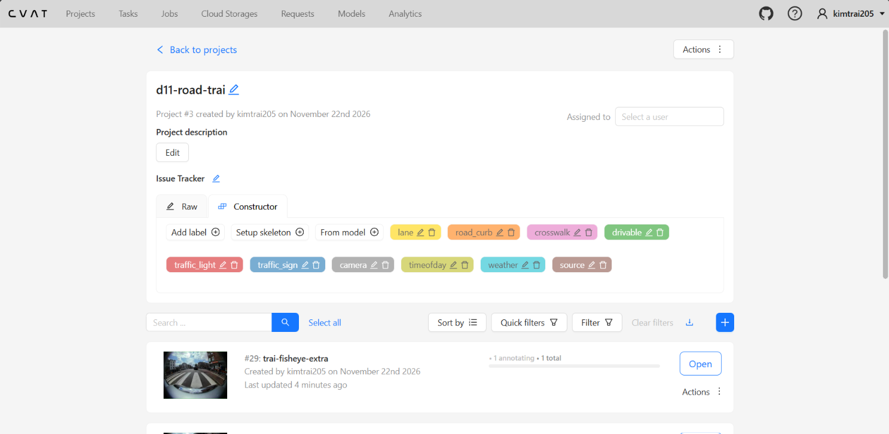
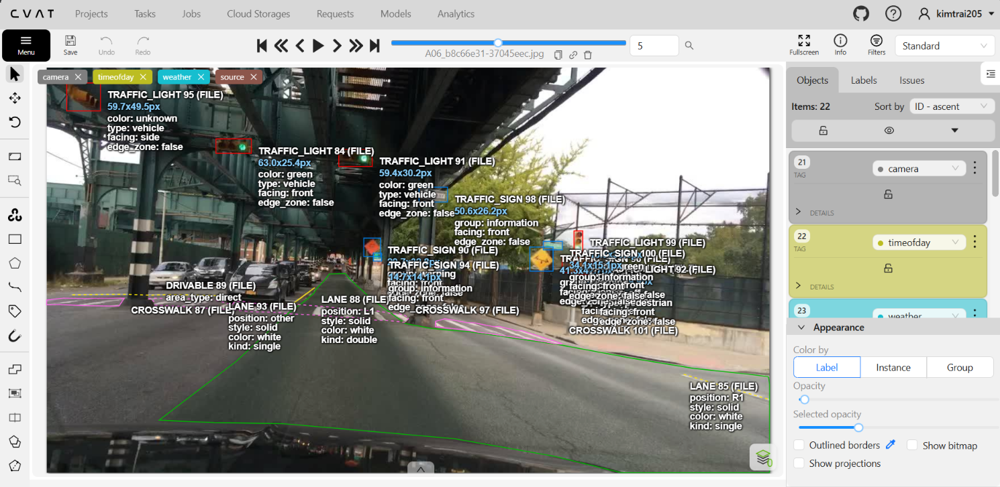
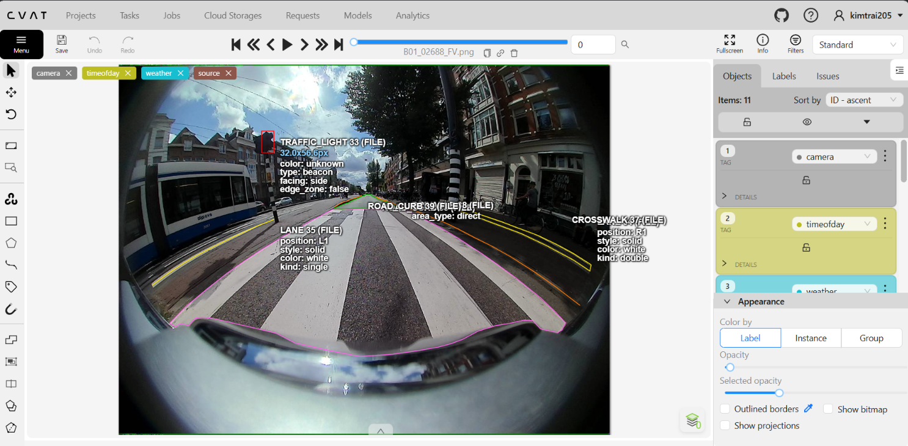
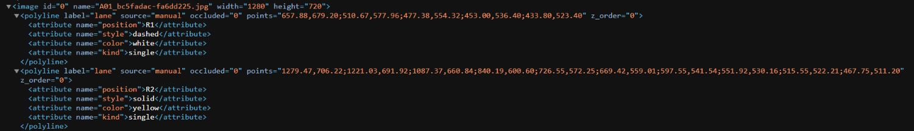

# Báo cáo cá nhân — Ngày 11
Họ tên: **Bùi Kim Trại**  Mã học viên: **2A202603176**  
Phiên bản CVAT (Help → About): *(điền sau khi mở CVAT)*  
Guideline: **Road v1.0**    Lần nộp (`revision` trong manifest): **1**  
Thời điểm export (ngày giờ trên CVAT): **21/11/2026**  Số lần nộp lại sau Rework: **0** *(cập nhật sau khi sửa và nộp lại)*

## 1. Kiểm project
| Mục | Đúng như guideline Road v1.0? | Ghi chú |
| --- | --- | --- |
| 6 label, đúng kiểu | Có | lane (polyline), road_curb (polyline), crosswalk (polygon), drivable (polygon), traffic_light (rectangle), traffic_sign (rectangle) |
| Thuộc tính và giá trị | Có | lane: position/style/color/kind; drivable: area_type; traffic_light: color/type/facing/edge_zone; traffic_sign: group/facing/edge_zone |
| 4 tag ảnh | Có | camera, timeofday, weather, source — mỗi tag một thuộc tính select `value` |

Cách kết thúc polyline trên bản CVAT này: nhấn **N** hoặc double-click điểm cuối để kết thúc vẽ.  
Cách đặt tag ảnh trên bản CVAT này: chọn label loại Tag từ thanh bên trái → click nút **+** để thêm tag → chọn giá trị `value` trong hộp thuộc tính.

## 2. Số lượng đã gán
| Task | Ảnh | lane | road_curb | crosswalk | drivable | traffic_light | traffic_sign |
| --- | ---: | ---: | ---: | ---: | ---: | ---: | ---: |
| front (A01–A12) | 12 | 41 | 4 | 10 | 30 | 24 | 33 |
| front-extra (đã làm 4 / 4) | 4 | 17 | 2 | 6 | 11 | 7 | 16 |
| fisheye (B01–B08) | 8 | 28 | 14 | 12 | 19 | 9 | 12 |
| fisheye-extra (đã làm 4 / 4) | 4 | 10 | 3 | 5 | 6 | 0 | 0 |

*Số liệu front/fisheye lấy từ manifest; front-extra và fisheye-extra lấy từ output `road_check lint`.*

## 3. Bảng ca khó
| Ảnh | Nhãn | Phân vân giữa | Đã chọn | Lý do |
| --- | --- | --- | --- | --- |
| A05 | lane L1/R1 | Vẽ vạch suy đoán vs. bỏ qua | Không vẽ | Không thấy vạch sơn trong ảnh; coach xác nhận miễn QC1-02 |
| A09 | lane R1 | Vẽ vạch suy đoán vs. bỏ qua | Không vẽ | Vạch bên phải không nhìn rõ; coach xác nhận miễn QC1-02 |
| A14 | lane R1 | Vẽ vạch suy đoán vs. bỏ qua | Không vẽ | Ảnh đêm, vạch bên phải mờ hoàn toàn; coach xác nhận miễn QC1-02 |
| A06 | lane other | Vạch dừng ngang giao lộ: gán lane hay bỏ qua | Gán lane, position=other, occluded=1 | Đây là vạch sơn thực trên mặt đường, dùng position=other vì không phải L1/R1; lint cảnh báo chiều nhưng là vạch ngang nên y gần nhau là đúng |
| A08 | lane other | Vạch ngang giao lộ: lane hay không | Đã gán lane — theo phiếu QC 1 nhận được đây là lỗi nặng, cần xóa | Vạch ngang không phải vạch phân làn dọc theo hướng di chuyển |
| A10 | drivable | Polygon có khoét theo thân xe không | Đã khoét — theo phiếu QC 1 là lỗi, cần sửa | Lẽ ra phải vẽ theo mặt đường khi trống, không bám thân xe |
| B02 | lane R1 | Polyline một chiều vs. vẽ theo cả hai mép | Đã vẽ hai chiều tạo vòng — theo phiếu QC 1 là lỗi, cần vẽ lại | Quy tắc: polyline hở theo tâm vạch từ gần ra xa, không vòng lại |
| B10 | traffic_light / traffic_sign | Có biển hoặc đèn ở ảnh fisheye_left này không | Không gán | Góc camera bên, không thấy đèn/biển đủ rõ |

## 4. Phiếu QC 1 nhận được
Bạn kiểm lô của tôi: **Ngô Thị Minh Quang** (`ngothiminhquang`)  Quyết định nhận được: **Rework**

| Mã lỗi | Ảnh | Nhãn | Mức | Đồng ý? | Đã sửa? |
| --- | --- | --- | --- | --- | --- |
| F01 — QC1-03 | A08 | lane#32 (vạch ngang giao lộ) | Nặng | Có — đây không phải vạch làn dọc | Sẽ xóa và export lại |
| F02 — QC1-07 | A10 | drivable#14 (direct, khoét theo xe trước) | Chính | Có — biên không được bám thân xe | Sẽ vẽ lại |
| F03 — QC1-07 | A10 | drivable#16 (alternative, lõm theo xe phải) | Chính | Có | Sẽ vẽ lại |
| F04 — QC1-07 | A10 | drivable#0 (alternative, khoét theo xe đỗ trái) | Chính | Có | Sẽ vẽ lại |
| F05 — QC1-09 | A10 | traffic_sign#9 (group sai) | Chính | Có — biển NO PARKING phải là prohibitory | Sẽ đổi group |
| F06 — QC1-04 | B02 | lane#3 R1 (polyline vòng lại) | Chính | Có — phải là polyline hở từ gần ra xa | Sẽ vẽ lại |

**Ca mơ hồ coach đã xác nhận:**  
- A05 thiếu L1/R1: coach xác nhận miễn — không có vạch trong ảnh.  
- A09 thiếu R1: coach xác nhận miễn — không thấy vạch bên phải.  
- A14 thiếu R1: coach xác nhận miễn — ảnh đêm, vạch không nhìn rõ.  
- A06 cảnh báo chiều vẽ: coach xác nhận không phải lỗi — polyline `other` là vạch dừng ngang giao lộ.

## 5. Kiểm file export
| File | Mở lại được? | Số shape ảnh 1 (A01/B01) | Số shape ảnh 2 (A02/B02) | Tag camera có trong XML? |
| --- | --- | --- | --- | --- |
| trai-front.zip | Có | A01: lane 4, drivable 3, traffic_sign 1 | A02: lane 3, drivable 3, road_curb 1 | Có — `<tag label="camera"><attribute name="value">front</attribute>` |
| trai-fisheye.zip | Có | B01: lane 2, drivable 1, road_curb 2, crosswalk 1, traffic_light 1 | B02: lane 2, drivable 2, road_curb 1, crosswalk 2, traffic_light 3 | Có — giá trị đúng theo hậu tố FV/RV/MVL/MVR |

Lệnh lint sau khi export:
```
$env:PYTHONPATH="src"
python -m road_lab.road_check lint trai-front.zip trai-fisheye.zip
```
Kết quả: 20 ảnh, 4 cảnh báo (3 nặng ở A05/A09 thiếu L1/R1 và 1 chính ở A06 chiều vẽ) — tất cả đã được coach xác nhận miễn.

## 6. Ảnh chụp màn hình

1. **Tab Labels của project** — hiển thị 6 label và 4 label Tag với đủ thuộc tính:  
   

2. **Một ảnh camera trước đã gán đủ (làn, vùng lái, đèn/biển)** — ví dụ ảnh A08:  
   

3. **Một ảnh fisheye đã gán, phóng to đoạn polyline cong** — ví dụ ảnh B03:  
   

4. **Đoạn XML có `<polyline label="lane">`**:  
   

## 7. Tự đánh giá
**Lỗi mắc nhiều nhất hôm nay:** QC1-07 — vẽ polygon `drivable` khoét theo thân xe.  
Cách tránh ở Ngày 20: khi vẽ polygon vùng lái, hình dung mặt đường khi không có xe — vẽ theo đường kẻ làn/vỉa hè/lề đường, không theo đường bao thân xe. Kiểm lại mép polygon bằng cách phóng to.

**Liên hệ với model:** Lỗi F01 ở A08 (gán vạch ngang giao lộ thành `lane`) là ví dụ điển hình của nhãn thừa (false positive). Nếu dữ liệu huấn luyện chứa vạch stop line được gán nhãn `lane`, model sẽ học rằng vạch ngang tại giao lộ là làn xe — dẫn đến khi triển khai, hệ thống LKA (Lane Keeping Assist) có thể nhận nhầm vạch dừng là biên làn và ra tín hiệu lái sai. Tương tự, lỗi F06 (polyline R1 vẽ vòng lại) làm cho model học sai hình dạng kỳ vọng của một vạch làn, ảnh hưởng đến bài toán ước lượng vị trí xe trong làn (lane centering).

## 8. (Tùy chọn, buffer) Từ polyline đến đích row-anchor

*(Phần này không bắt buộc và không tính điểm. Có thể bổ sung sau.)*

| y | 720 | 680 | 640 | 600 | 560 |
| --- | ---: | ---: | ---: | ---: | ---: |
| x của chúng tôi (R1 A01) |  |  |  |  |  |
| x của bạn kia |  |  |  |  |  |
